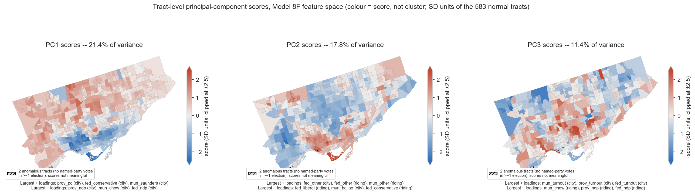

# Data, Methods, and Results

This analysis groups Toronto census tracts based on how they voted and participated across three recent elections. Rather than starting from demographic categories or assuming a simple downtown-left/suburbs-right divide, we use election results to identify tracts with similar political profiles, then use Census data to describe the kinds of places those groups represent.

The analysis covers all 585 Toronto census tracts (CTs) and three elections: the 2023 Toronto mayoral election, the 2025 Ontario provincial election, and the 2025 federal election. The clustering itself uses only voting and turnout. Housing, income, education, immigration, racialization, age, and other Census characteristics receive no weight in the model and are joined only after the political groups have been identified.

The final model was selected after testing alternative vote-share representations, ways of accounting for local electoral context, dimensionality-reduction methods, clustering approaches, and numbers of groups. The aim was to find a model that separated neighbourhoods reasonably well, remained interpretable, and preserved meaningful distinctions under plausible alternatives.

## 1. Data and spatial interpolation

Election results are reported by voting poll, while this analysis works at the census tract level. We therefore use population-weighted areal interpolation to transfer poll-level results to census tracts. Smaller dissemination areas estimate where the relevant voting-age population lives within overlapping polygons. The weighting population is Canadian citizens aged 18 and over from the 2021 Census.

This improves on simple area weighting. If a poll overlaps two census tracts but most of its adult-citizen population lives in one, most votes are allocated there rather than assuming voters are distributed evenly across land area. Within dissemination areas, population is distributed according to the area of each intersecting piece; geographic area is used as a fallback where population information is unavailable.

For each tract, candidate or party shares are calculated from valid votes cast. The municipal election includes Olivia Chow, Ana Bailão, Mark Saunders, Anthony Furey, Josh Matlow, and an "other" category. Provincial and federal elections similarly include the major parties and an "other" category.

Turnout is defined throughout the main model as:

**votes cast / Canadian citizens aged 18+**

This differs from official turnout, which generally uses registered electors as its denominator. The citizen-based measure provides one consistent estimate of the potentially eligible population across all three elections without making voter-list registration itself part of the participation measure.

Two census tracts contain anomalous election records in which no named-party or candidate votes were recorded in at least one election, causing "other" to approach 100 per cent. They remain in the final dataset but are excluded when fitting k-means, then assigned to the nearest cluster centre. Sensitivity tests show that leaving them out of the PCA changes cluster membership only modestly (ARI ≈ 0.88).

## 2. Representing political similarity

The clustering uses 19 political measures:

| Election | Variables |
| --- | --- |
| 2023 mayoral | Turnout; Chow; Bailão; Saunders; Furey; Matlow; Other |
| 2025 provincial | Turnout; PC; NDP; Liberal; Green; Other |
| 2025 federal | Turnout; Liberal; Conservative; NDP; Green; Other |
| 2021 Census | No variables enter the clustering |

We tested standardized raw vote shares, Hellinger transformations, centred log-ratio transformations, and other alternatives.

The final model uses each tract's percentage-point deviation from Toronto overall. If the provincial NDP receives 23 per cent citywide and 43 per cent in a tract, for example, that tract is represented as +20 points relative to Toronto.

More specialized transformations are reasonable for compositional vote-share data, but make distances between neighbourhoods harder to translate back into recognizable electoral differences. They did not improve the clusters enough to justify that loss of interpretability. Once features are standardized, raw shares and city-relative deviations also produce essentially the same distance structure, because subtracting the same citywide value from every tract is removed again through centring.

## 3. Equal weighting across elections

The mayoral election contains seven variables and the provincial and federal elections six each. If all standardized columns were entered equally, the mayoral election could receive more influence simply because it contains more candidate measures.

We therefore use block weighting:

| Election | Weighting |
| --- | --- |
| Municipal | Seven standardized variables, divided by √7 |
| Provincial | Six standardized variables, divided by √6 |
| Federal | Six standardized variables, divided by √6 |

This gives each election approximately equal total input variance. The same procedure is applied separately to the city-relative and local-relative feature sets before the two are combined in a 50/50 blend.

The retained PCA space remains close to this intended balance: retained variance across the six election/view blocks ranges from approximately 0.215 to 0.231. Turnout also does not dominate the model. Its three variables account for about 15.9 per cent of block-weighted input variance and 16.5 per cent of retained PCA variance.

## 4. Citywide patterns and local electoral context

A tract's vote can reflect both its position within Toronto overall and the electoral context surrounding it. If a tract gives the provincial NDP 35 per cent while Toronto gives the party 23 per cent, it is +12 points relative to the city. If its riding gives the NDP 40 per cent, however, it is simultaneously −5 points relative to its riding.

These measures answer different questions:

- **City-relative:** where does the tract sit within Toronto's overall political geography?
- **Local-relative:** does it vote differently from the electoral district around it?

The local geography is defined separately for each election. The 2023 mayoral election uses Toronto's 25 municipal wards, while the 2025 Ontario election uses the corresponding 25 provincial electoral districts. The 2025 federal election occurred under the new federal districts established by the 2023 Representation Order, so its results use the boundaries that actually applied in 2025 rather than the older 25-district geography. [Elections Canada provides the federal electoral district maps here](https://www.elections.ca/map_01.aspx?lang=e&section=res&t=06_ON&w=1).

This difference affects only the local-relative half of the model; city-relative results are unchanged.

We tested city-only models, local-only models, nearby-tract residuals, and regression-based district adjustments. Local-only models can hide meaningful absolute differences, while city-only models can make a district-wide candidate or campaign effect appear neighbourhood-specific.

The final Model 8F therefore combines city-relative and local-relative measures equally. More city-heavy specifications remained close to the city-only solution, while heavier local weighting weakened separation and changed cluster membership more substantially.

One technical detail remains in the saved model. Tract turnout uses the adult-citizen denominator throughout, but the local turnout benchmark was averaged using registered-elector weights in the model-exploration pipeline. Recomputing that benchmark using adult-citizen weights changes local turnout deviations by roughly 0.35–0.55 percentage points on average, with the largest differences around 3.2 points provincially. These differences are small relative to the cluster-level turnout gaps below.

## 5. PCA and the structure of the political data

The final representation contains 38 columns: city-relative and local-relative versions of each of the 19 political measures. Many are correlated, both because vote shares within an election are compositional and because similar political alignments recur across elections.

We therefore use principal component analysis (PCA) to replace these correlated features with a smaller set of dimensions capturing the main ways Toronto census tracts differ politically.

We retain enough components to explain at least 90 per cent of total variance. Fourteen components are required, explaining approximately 90.4 per cent:

| Component | Variance explained | Cumulative |
| --- | --- | --- |
| PC1 | 21.4% | 21.4% |
| PC2 | 17.8% | 39.1% |
| PC3 | 11.4% | 50.5% |
| PC4 | 8.1% | 58.7% |
| PC5 | 6.0% | 64.7% |
| … | … | … |
| PC14 | 1.7% | 90.4% |

The largest loadings on the first five components are:

| PC | Largest loadings |
| --- | --- |
| PC1 | Provincial PC +0.279; Provincial NDP −0.274; Chow −0.273; Federal NDP −0.265; Federal Conservative +0.264; Saunders +0.234 |
| PC2 | Federal Other +0.347; Federal Other vs. riding +0.345; Municipal Other vs. ward +0.321; Provincial Other vs. riding +0.284; Municipal Other +0.263; Provincial Other +0.246 |
| PC3 | Municipal turnout +0.342; Provincial turnout +0.317; Chow vs. ward −0.298; Federal turnout +0.283; Bailão vs. ward +0.267; Municipal turnout vs. ward +0.249 |
| PC4 | Federal turnout vs. riding +0.293; Federal Conservative vs. riding −0.287; Provincial turnout vs. riding +0.285; Provincial PC vs. riding −0.275; Federal turnout +0.270; Provincial Liberal +0.254 |
| PC5 | Provincial Liberal vs. riding +0.497; Provincial NDP vs. riding −0.335; Provincial Liberal +0.315; Federal NDP vs. riding −0.311; Federal Liberal +0.298; Federal Liberal vs. riding +0.259 |

PC1 is the clearest broad political axis. Higher values correspond to stronger PC, Conservative, and Saunders voting; lower values to stronger NDP and Chow voting. It also has a strong geographical pattern: among the 583 non-anomalous tracts, Moran's I is approximately 0.77 and its Spearman correlation with distance from downtown is +0.63.

This is recognizable as a broad core-to-suburban, progressive-to-conservative gradient, although it is not simply distance from downtown. The highest scores concentrate particularly in parts of Etobicoke and North York rather than increasing uniformly toward Toronto's edge.

PC3 captures turnout alongside ward-relative Chow-versus-Bailão differences, while PC4 helps distinguish Civic Liberals from the other clusters.

PC2 requires more caution. Its six largest loadings are "other" candidate or party variables, and two anomalous tracts account for roughly 77 per cent of its total sum of squares. Refitting PCA without these tracts moves cluster membership only modestly (ARI ≈ 0.88, with the Soft-Left Belt least stable: 74 per cent of its tracts stay together), indicating that they distort PC2 much more than the final typology.

We also explored UMAP. It produces cleaner two-dimensional separation, but partly by reshaping distances between observations. Because clustering depends on those distances, PCA is retained for the model and UMAP only for exploratory visualization.

## 6. Clustering and choosing five groups

The retained PCA scores are clustered using k-means. We compared k-means with Ward hierarchical clustering; k-means generally produced stronger separation while remaining simpler to reproduce and interpret.

The final specification uses 30 initializations and a fixed random seed of 42. We compare solutions from k = 3 through k = 7:

| k | Silhouette | ARI vs. k=5 | Main change relative to five groups |
| --- | --- | --- | --- |
| 3 | 0.1669 | 0.552 | Soft-Left Belt splits, with most of its tracts joining Progressive Core; Civic Liberals divided across groups |
| 4 | 0.1664 | 0.741 | Core and Soft-Left Belt remain distinct; Civic Liberals loses standalone cluster |
| 5 | 0.1677 | 1.000 | Selected solution |
| 6 | 0.1409 | 0.817 | New mixed group splits the Core/Soft-Left boundary |
| 7 | 0.1459 | 0.779 | Further fragmentation |

Differences between three, four, and five groups are very small, so silhouette alone does not determine the choice. At k = 4, approximately 96 per cent of Progressive Core, 87 per cent of Soft-Left Belt, 96 per cent of Suburban Conservatives, and 99 per cent of Low-turnout Suburbanite tracts remain together. The main change is Civic Liberals: only about 45 per cent remain together.

The share of each final group's tracts that stay together in a single cluster at the other values of k is:

| Final group | k=3 | k=4 | k=6 | k=7 |
| --- | --- | --- | --- | --- |
| Progressive Core | 100% | 96% | 60% | 61% |
| Soft-Left Belt | 59% | 87% | 58% | 47% |
| Civic Liberals | 51% | 45% | 97% | 94% |
| Suburban Conservatives | 91% | 96% | 100% | 95% |
| Low-turnout Suburbanites | 98% | 99% | 92% | 91% |

Five groups therefore preserve four comparatively stable geographies while retaining a fifth, substantively distinctive but more weakly bounded Civic Liberal group. Six and seven groups produce weaker separation and greater fragmentation. Five is therefore a useful level of resolution, not evidence that Toronto contains exactly five natural political types.

## 7. Electoral results of the five clusters

The five groups contain between 77 and 185 census tracts. Low-turnout Suburbanites are the largest, containing nearly one-third of Toronto's population, while Civic Liberals are the smallest.

| Cluster | CTs | Total population | Share of Toronto population | Citizens 18+ | Share of Toronto citizens 18+ |
| --- | --- | --- | --- | --- | --- |
| Progressive Core | 109 | 489,181 | 17.5% | 348,360 | 18.6% |
| Soft-Left Belt | 85 | 415,371 | 14.9% | 289,900 | 15.5% |
| Civic Liberals | 77 | 384,759 | 13.8% | 260,320 | 13.9% |
| Suburban Conservatives | 129 | 614,394 | 22.0% | 418,845 | 22.4% |
| Low-turnout Suburbanites | 185 | 890,651 | 31.9% | 552,660 | 29.6% |

The following table reports descriptive cluster-level election results. Vote shares are weighted by valid votes cast; turnout is total votes cast divided by Canadian citizens aged 18+:

| Cluster | Mayoral turnout | Chow | Bailão | Provincial turnout | PC | NDP | Liberal | Federal turnout | Liberal | Conservative | NDP |
| --- | --- | --- | --- | --- | --- | --- | --- | --- | --- | --- | --- |
| Progressive Core | 44.9 | 52.7 | 23.1 | 53.7 | 15.9 | 51.1 | 28.6 | 73.4 | 62.4 | 20.9 | 14.5 |
| Soft-Left Belt | 44.4 | 39.8 | 31.5 | 51.2 | 23.9 | 36.7 | 35.7 | 75.6 | 61.5 | 28.3 | 8.6 |
| Civic Liberals | 44.6 | 31.4 | 37.4 | 54.1 | 36.6 | 8.0 | 50.7 | 79.2 | 58.9 | 36.9 | 3.0 |
| Suburban Conservatives | 38.3 | 24.6 | 43.0 | 45.8 | 47.8 | 6.6 | 40.6 | 68.7 | 51.4 | 45.1 | 2.7 |
| Low-turnout Suburbanites | 29.5 | 36.7 | 28.3 | 40.2 | 42.4 | 14.8 | 38.6 | 63.2 | 58.9 | 35.7 | 4.0 |
| Toronto overall | 38.7 | 37.2 | 32.5 | 47.6 | 34.0 | 23.3 | 38.4 | 70.5 | 58.4 | 33.8 | 6.4 |

The Progressive Core has the strongest progressive profile: the provincial NDP receives 51.1 per cent and Chow 52.7 per cent, with above-average turnout across all three elections.

The Soft-Left Belt leans in the same direction but less strongly. Provincial NDP support remains above Toronto overall, while turnout is also consistently above average. Matlow performs most strongly here.

Civic Liberals combine high turnout with unusually strong provincial Liberal voting and weak NDP support. Bailão leads Chow municipally, while the federal Liberal advantage is narrower than in the two progressive clusters.

Suburban Conservatives record the strongest PC and federal Conservative results and the weakest NDP/Chow results. The federal Liberals still narrowly lead there, so the label describes relative political orientation rather than an across-the-board Conservative majority.

Low-turnout Suburbanites are distinguished most consistently by participation. Turnout falls about 9.2 points below Toronto municipally, 7.4 points provincially, and 7.3 points federally, while partisan preferences vary across contests. This mixed pattern is why the cluster is named for turnout rather than ideology.

## 8. Socioeconomic results

Census characteristics are joined only after clustering and receive zero weight in determining membership. They describe the kinds of places in each political group rather than explain individual behaviour.

| Cluster | Density / km² | Avg. age | HH size | Median pre-tax individual income | Renters | Shelter burden | Canadian citizens | Racialized / visible minority | Recent migrants | Bachelor's+ | Car commute | Transit commute | 60+ min commute |
| --- | --- | --- | --- | --- | --- | --- | --- | --- | --- | --- | --- | --- | --- |
| Progressive Core | 9,023 | 40.3 | 2.05 | $43,840 | 58.6% | 34.0% | 85.9% | 41.8% | 18.2% | 48.0% | 42.1% | 30.8% | 10.1% |
| Soft-Left Belt | 6,133 | 41.1 | 1.97 | $53,115 | 53.2% | 36.4% | 83.2% | 39.0% | 22.7% | 55.5% | 48.5% | 27.0% | 9.1% |
| Civic Liberals | 4,024 | 42.7 | 2.23 | $46,507 | 43.7% | 33.4% | 83.2% | 49.9% | 17.9% | 47.5% | 63.7% | 25.8% | 11.3% |
| Suburban Conservatives | 3,025 | 43.3 | 2.67 | $42,040 | 36.7% | 28.3% | 85.3% | 48.0% | 12.6% | 38.8% | 71.3% | 21.3% | 11.7% |
| Low-turnout Suburbanites | 3,630 | 40.5 | 2.77 | $33,455 | 47.4% | 31.4% | 78.8% | 78.7% | 15.6% | 28.9% | 66.6% | 27.2% | 15.7% |
| Toronto overall | 4,196 | 41.5 | 2.38 | $41,881 | 48.1% | 32.5% | 82.7% | 55.7% | 16.8% | 41.1% | 61.0% | 26.2% | 12.5% |

The Progressive Core is the densest group and has the highest renter and transit-commuting shares. The Soft-Left Belt has the smallest households, highest recent-migrant share, and highest median pre-tax individual income, bachelor's-degree attainment, and shelter-cost burden.

Civic Liberals have above-average income and educational attainment but are more car-oriented than the first two groups. Suburban Conservatives are the oldest, least renter-heavy, and most car-oriented group. Low-turnout Suburbanites have the largest households, lowest median pre-tax individual income and bachelor's attainment, longest commutes, and highest racialized/visible-minority share.

These differences are descriptive, not causal. The clustering was completed without Census characteristics, and tract-level associations cannot establish how individuals with particular characteristics voted.

Where numerator and denominator counts are available, percentages are calculated from the underlying counts rather than averaging tract percentages. Income is an exception. It is the 2021 Census median total (pre-tax) income in 2020 among income recipients aged 15 and over, and the reported cluster figure is a population-weighted average of tract medians. Missing values in two small-population tracts are excluded from affected calculations rather than treated as zero.

## 9. Robustness, cluster boundaries, and alternative specifications

The final model was not selected from one diagnostic. Earlier exploration tested:

- removing turnout;
- removing "other" vote categories;
- Hellinger and CLR transformations;
- k-means versus Ward hierarchical clustering;
- PCA versus nonlinear UMAP representations;
- alternative forms of local residual;
- different city/local weighting ratios; and
- the influence of geographically concentrated candidate support.

These tests generally show a trade-off between separation and interpretability. More specialized transformations can produce cleaner statistical separation while making the resulting distances harder to connect to recognizable election results.

### How much does turnout matter?

Removing turnout entirely tests how heavily participation shapes the typology:

| Cluster | Tracts remaining together |
| --- | --- |
| Progressive Core | 93% |
| Soft-Left Belt | 75% |
| Civic Liberals | 42% |
| Suburban Conservatives | 97% |
| Low-turnout Suburbanites | 86% |

Turnout is particularly important to Civic Liberals, while the Progressive Core and two suburban groups remain highly recognizable without it. Low-turnout Suburbanites also remain largely intact because their political differences extend beyond turnout alone.

### Local candidate effects

We tested whether Josh Matlow's geographically concentrated 2023 support disproportionately generates a cluster boundary. Reducing his ward-relative contribution to 20 per cent leaves the k=5 solution almost unchanged, with ARI = 0.981. This makes it unlikely that the Soft-Left Belt/Civic Liberal distinction is simply an artifact of one mayoral candidate.

### How hard are the cluster boundaries?

K-means assigns every tract to one group even when it lies close to another cluster. We therefore examine distances to cluster centroids and silhouette scores.

The Progressive Core is the most clearly separated group. The Soft-Left Belt and Civic Liberals have the softest boundaries: approximately 29 per cent and 36 per cent of their tracts, respectively, have negative silhouette values.

The closest cluster centroids are Suburban Conservatives and Low-turnout Suburbanites, at approximately 0.78 in retained PCA space, although both remain comparatively stable under alternative k values and turnout removal. Civic Liberals sit between several groups, consistent with their weaker robustness at k=4.

These diagnostics support treating the clusters as overlapping summaries of a continuous political geography rather than sharply separated populations.

## 10. Naming and interpreting the clusters

K-means produces numeric cluster IDs. The public names are applied afterward based primarily on the electoral variables that define the model rather than Census characteristics observed afterward.

**Progressive Core** describes the strongest progressive voting profile and its concentrated central geography.

**Soft-Left Belt** describes a less intensely progressive but still high-turnout group around and beyond the Core.

**Civic Liberals** combines high turnout, strong provincial Liberal voting, and weak NDP support.

**Suburban Conservatives** contains the strongest relative PC and federal Conservative results, concentrated largely in established suburban areas. It does not imply Conservative victories in every election.

**Low-turnout Suburbanites** foregrounds the group's most consistent distinction: markedly lower turnout alongside a mixed partisan profile.

The groups do not form a strict five-step ideological scale. A broad progressive-conservative dimension is important, but turnout, Liberal-versus-NDP differences, local context, and candidate effects create additional dimensions.

Municipal candidates are not assigned ideological scores in the model. Likewise, interpretations involving political history, suburban development, housing, immigration, inequality, or infrastructure are separate from the clustering result and require independent evidence.

## 11. Limitations

These are clusters of census tracts, not types of voters. A Progressive Core tract contains Conservative voters, a Suburban Conservative tract contains NDP voters, and a Low-turnout Suburbanite tract cannot tell us why any particular resident chose not to vote.

The Census comparisons are similarly ecological. Finding that a cluster has more renters or university graduates does not show that those characteristics caused its political profile.

Election results are estimated at census-tract level through population-weighted interpolation rather than observed directly at that geography. The method uses finer dissemination-area population information, but still requires assumptions about population distribution within overlapping areas.

Local-relative measures also use the electoral boundaries applying to each contest. Municipal and provincial results use Toronto's corresponding 25-district geography, while the 2025 federal election uses the newer federal boundaries. The local comparison is therefore election-specific rather than based on one fixed map across all three elections.

Two anomalous election records strongly affect PC2 but only modestly affect final cluster membership (ARI ≈ 0.88 when PCA is refit without them). Civic Liberals also warrant particular caution: they have a recognizable profile but are the least robust and most loosely bounded group, disappearing as a standalone cluster at k=4.

More generally, the modest silhouette scores show that Toronto's political geography is continuous and overlapping. The map necessarily draws harder boundaries than the data contain.

Finally, the model covers only three recent elections. Multiple contests reduce dependence on any single race, but candidates, campaigns, strategic voting, party coalitions, boundaries, and turnout circumstances remain part of the observed patterns.

The five groups are therefore best understood as empirically grounded summaries of Toronto's recent political geography. Five provides a useful level of resolution, but it is a modelling and storytelling choice rather than evidence that Toronto naturally consists of exactly five political populations.
